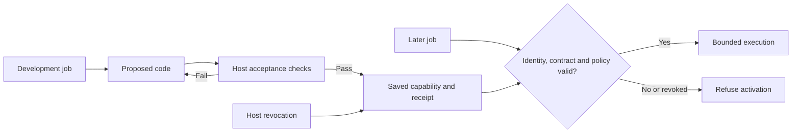

# Build, qualify and reuse a capability

YNOT's development foundation is an importable lifecycle for executable capabilities. The example makes a model-written schema repair available to a later process. Its contract, execution policy and revocation remain under host control.



## Run the example

From a source checkout installed with `pip install -e '.[dev,deno]'`:

```bash
python -m examples.ynot.capability_lifecycle --store /tmp/ynot-capabilities
python -m examples.ynot.capability_lifecycle --live --store local/foundation
```

The first command is deterministic: a deliberately faulty candidate fails, a supplied working implementation passes, a fresh process reuses it on four unseen inputs, then a fresh activation is blocked after revocation. This is a lifecycle control, not autonomous model behaviour.

The second command independently asks the same Codex model to solve the task through YNOT and a direct baseline. It uses the existing Codex CLI login and makes real model calls. `--model`, `--reasoning` and `--order ynot-first` are available. Each invocation creates a fresh directory and prints its location. Model requests and usage stay under that directory. Do not publish private inputs from a different task.

The example's inputs are public synthetic reference fixtures. An actual JSON Schema validator first rejects `null` against a valid OpenAPI 3.0 schema. The model sees that failure and the required semantics. It writes a function for the nullability part of an OpenAPI 3.0 to 3.1 migration. This is a real interoperability issue, exercised on bounded fixtures; it is not a complete migration product or evidence of customer demand. [OpenAPI 3.0 semantics](https://spec.openapis.org/oas/v3.0.3.html#schema-object), [OpenAPI 3.1 schema model](https://spec.openapis.org/oas/v3.1.0.html#schema-object).

## The reusable API

```python
from ynot import (
    AcceptanceCase, CapabilityContract, CapabilityStore,
    ExecutionAllowance, PyodideExecutor,
)

# Trusted application code supplies the contract and expected outputs.
contract = CapabilityContract(
    name="my-transform", version="1",
    input_schema={"type": "object"}, output_schema={"type": "object"},
    cases=[AcceptanceCase({"value": 2}, {"value": 3})],
)
executor = PyodideExecutor(timeout=30)
store = CapabilityStore("./capabilities", scope="my-project", executor_policy=executor.policy)
budget = ExecutionAllowance(10)
result = store.qualify(candidate_source, contract, executor, budget)
if result.promoted:
    output = store.run(result.capability_id, {"value": 4}, contract, executor, budget)
    store.revoke(result.capability_id, "Withdrawn by the host")
```

`candidate_source` defines `transform(payload)`. It receives JSON data and returns JSON data. Passing every host case permits promotion; partial or failed qualification does not. Failed attempts and later execution consume the allowance. The core accepts an injected executor so another host can supply a suitable boundary, but its policy identifier must describe that executor honestly.

Saved identity binds source, contract, scope and execution policy. Every `run` reloads and checks the artefact, contract and revocation. Changing a contract or policy requires qualification under a new identity. Revoking an existing identity cannot be undone by qualifying the same source again. Different projects have separate store scopes. Raw acceptance inputs and expected outputs are not saved in receipts, although generated source can itself contain data and needs appropriate review.

A supervisor may expose qualification and execution as approved tools. The reference uses one developer because this task supplies no reason for more. It does not demonstrate autonomous skill discovery, a specialist switch, automatic capability retrieval or distributed execution. The existing supervisor remains available independently.

## Execution boundary

`PyodideExecutor` sends candidate source into the retained DSPy Deno/Pyodide interpreter, never host-side `exec`. Each call starts a fresh interpreter with no mounted host paths, registered host tools or candidate network/environment permissions. Wall time and captured output are bounded by the host, including process-group cleanup. The runtime may download its interpreter assets during trusted startup.

This executor currently requires POSIX and the optional Deno dependency. Memory is not separately metered. It is not a hardened multi-tenant service. The store assumes a trusted local owner and a single writer. Its checksums detect inconsistency, not malicious replacement by someone who controls the store. Acceptance cases are finite and do not prove general correctness. The existing supervisor's Python callbacks are separate trusted tools, not automatically isolated by this executor.

## Matched comparison

Both live arms receive the same task, observed failure, public contract semantics, pinned model, reasoning setting and at most three candidate attempts. Neither receives acceptance inputs, expected outputs, the supplied control implementation or later reuse fixtures. Candidate code is frozen before later inputs are opened. A candidate can pass first time; no failure or extra specialist is forced.

The direct path uses the same executor and host acceptance cases, saves its passing Python file and reuses it in a fresh process. It receives the same per-case feedback on repair. YNOT uses its standard qualification and activation API. These are matched acquisition and reuse paths, not a contest between a full supervisor and a weaker one-shot baseline. The direct path is bespoke baseline glue; maintenance savings from replacing that glue are not measured here.

Count model calls, provider-reported input/output usage, every attempted execution and wall time through fresh-process reuse. The intentionally faulty candidate and post-run revocation are separate controls. They do not count as competitive safety wins against a direct implementation allowed equivalent controls. Runtime cache warm-up and provider latency can affect timing; do not infer speed from a few runs. No cash price is inferred from subscription token counts.

See [the recorded results](2026-11-02-foundation.md). Earlier research and Deputy comparisons remain in the [continuation record](HANDOFF.md).

## Grow the foundation through useful work

The next development should supply a second application and independently authored tasks. Keep generation, qualification and evaluation sets separate. Let each system retain its own accepted code. Include current DSPy programme optimisation, acquisition and repair costs in the baseline, rather than claiming that DSPy only optimises prompts. Vary order, repeat runs and report failed transfer as well as successful reuse.

The ambitious target is ten times as many independently accepted unseen tasks per fixed inference budget, with no increase in incorrect or unsafe changes. An inference-free repeat of a small transformation cannot establish it. Publish total work, correctness and cost, plus an ablation showing what the qualification lifecycle contributes. Add capability selection, contract migration or new execution backends when the next job demonstrates the need; keep the API useful to ordinary development code throughout.
